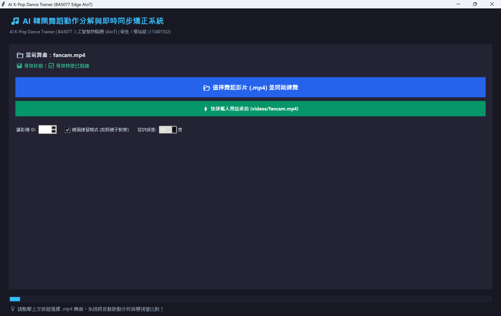
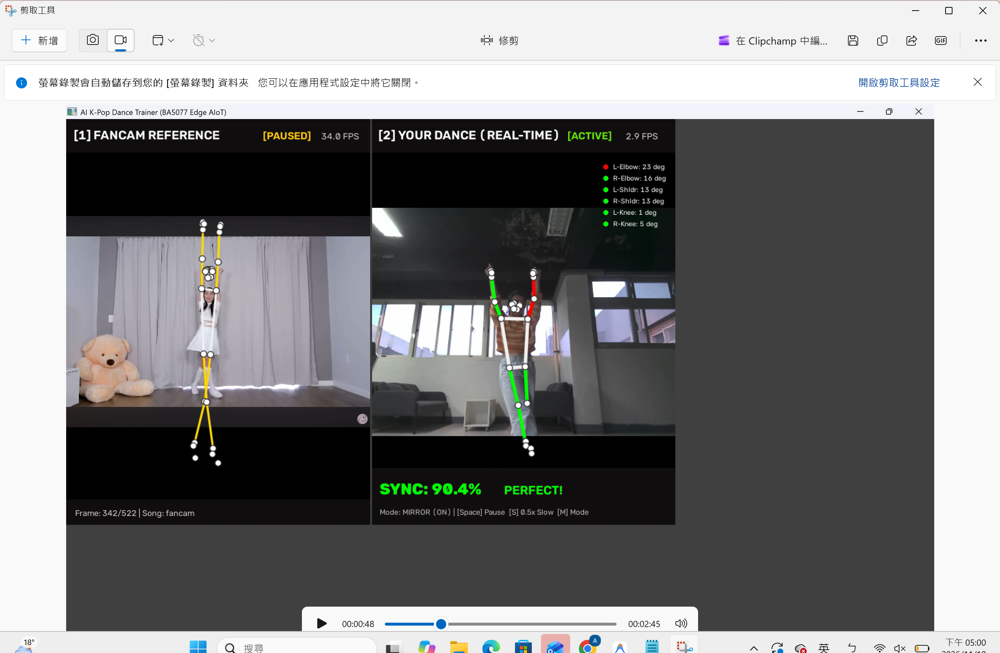
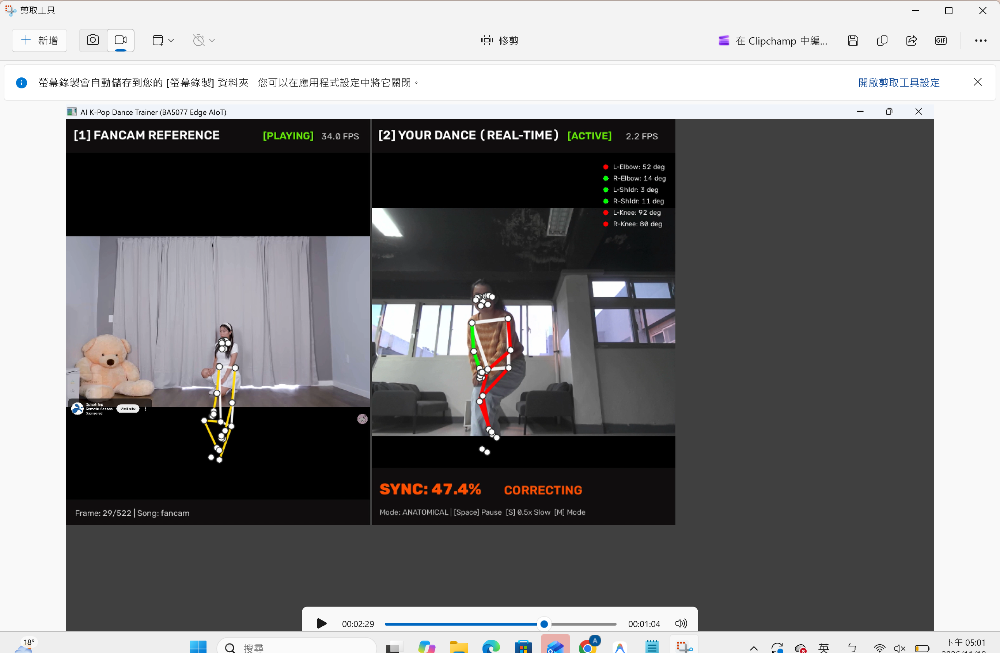
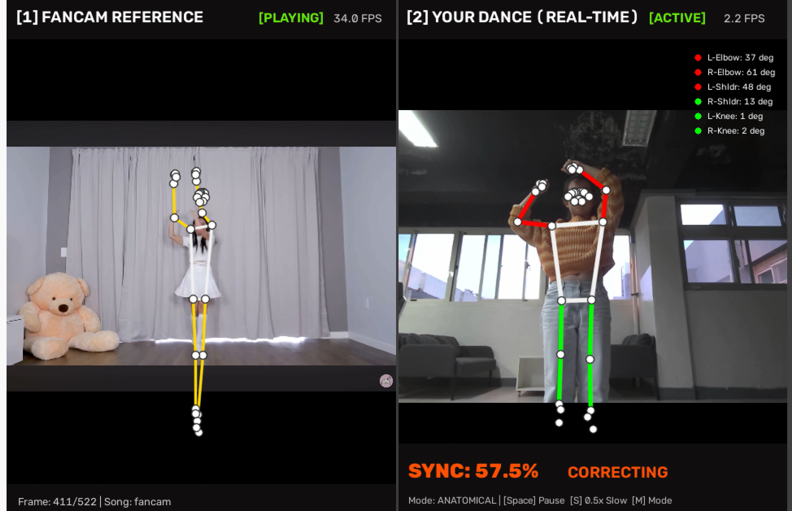

# AI 韓團舞蹈動作分解與即時同步矯正系統
## (AI K-Pop Dance Trainer)

[](https://github.com)
[](https://www.raspberrypi.com/)
[](https://developers.google.com/mediapipe)
[](https://www.python.org/)

---

## 📌 課程資訊 (Course Information)
- **課程代號與名稱**：BA5077 人工智慧物聯網 (AIoT)
- **學生姓名 (Name)**：張瑜庭
- **學生學號 (Student ID)**：113401532
- **作業項目**：個人實作專案 (Personal Implementation Project)

---

## 🎯 專案目的 (Project Purpose)
近年 K-Pop 流行文化風靡全球，舞蹈愛好者多藉由「單人直拍 (Solo Fancam)」或練習室影片自我模仿練習。然而傳統自學練舞面臨兩大核心痛點：
1. **難以察覺微小動作偏差**：練習者無法同時專注看教學影片並客觀評估自己肢體關節的角度與姿態。
2. **缺乏即時矯正與視覺回饋**：回放自拍影片比對耗時耗力，缺乏動態、即時的指引與同步評分。

本專案旨在打造一套**輕量級 Edge AIoT 舞蹈訓練輔助系統**，讓使用者僅需一台邊緣運算裝置（如 Raspberry Pi 4B/5 或一般筆記型電腦）搭配平價 USB/內建鏡頭，即可實現：
- **左右雙分割視窗即時比對**：左側播放明星直拍標準動作，右側為鏡像化使用者視訊。
- **一鍵自動化分析流程 (GUI Launcher)**：使用者透過簡潔的圖形介面選取任一本機舞曲 `.mp4`，系統自動判斷特徵庫並在背景無縫萃取骨架，自動啟動即時練舞。
- **即時關節角度幾何比對**：逐幀分析六大核心關節角度（雙手肘、雙肩膀抬起、雙膝蓋彎曲），容許誤差 ±20 度。
- **骨架動態色彩回饋**：標準姿勢呈綠色高亮、偏差部位呈紅色警示，並即時計算總體同步率（Sync %）。
- **動作分解互動控制**：支援一鍵暫停定格、0.5 倍慢動作分解與無縫自動循環播放，打造最友善的自學練舞體驗。

---

## 🤖 與 AI / Edge Computing 的關聯性 (AI & Edge Computing Relevance)
1. **邊緣運算負載最佳化（離線預運算 + 即時輕量推論）**：
   - 樹莓派等 Edge AIoT 裝置的 CPU/GPU 算力有限，若雙視窗同時執行兩路 MediaPipe 姿態估計，幀率將嚴重暴跌至個位數。
   - 本專案採用**雙軌架構 (Dual-Track Architecture)**：標準教學影片透過離線腳本 (`extract_pose.py`) 預先萃取 33 個關鍵點與 6 大關節幾何角度，儲存為輕量 JSON；即時執行時主程式僅需對本機鏡頭執行單路推論，並將模型複雜度設為 `model_complexity=0`，確保樹莓派能穩定維持 20~30 FPS 的順暢度。
2. **邊緣幾何姿態學 (Edge Pose Geometry)**：
   - 利用 MediaPipe Pose 輸出之標準化座標向量，在邊緣端直接運算歐幾里得幾何角度與容許誤差比對，省去高運算量深度比對網路，大幅降低能耗與硬體門檻。
3. **無痛擴充性與自動化管線 (Automated Pipeline)**：
   - 整合 Tkinter 圖形介面啟動器 (`launcher.py`)，更換任何舞曲僅需「一鍵點選」，系統自動於背景調度 MediaPipe 萃取特徵，無痛切換不同舞曲，無需修改任何程式邏輯。

---

## 📁 專案架構 (Project Structure)
```text
ai-kpop-dance-trainer/
├── README.md               # 專案完整說明文件與課程資訊 (本文件)
├── REFLECTION.md           # 開發技術挑戰、解決方案與學習心得
├── requirements.txt        # 依賴套件清單 (OpenCV, MediaPipe, NumPy)
├── run_trainer.bat         # Windows 一鍵啟動批次檔 (直接呼叫 GUI 啟動器)
├── run_trainer.ps1         # PowerShell 啟動腳本
├── EVIDENCE/               # 成果截圖與展示區 (包含雙視窗比對、警告與 GUI 截圖)
│   └── README.md           # 成果圖片置放指引
├── videos/                 # 放置韓團單人直拍 .mp4 來源影片 (如 fancam.mp4)
│   └── README.md           # 影片規格建議與置放指引
├── data/                   # 存放預處理萃取之骨架幾何 .json 檔案 (如 fancam_pose.json)
├── models/                 # MediaPipe 姿態估計輕量與高精度模型 (.task)
└── SOURCE/
    ├── __init__.py         # 模組初始化標記
    ├── launcher.py         # 🌟 一鍵選擇影片自動比對之圖形介面啟動器 (Tkinter GUI)
    ├── pose_utils.py       # 跨平台通用偵測器、關節角度計算、骨架繪製與 HUD 模組
    ├── extract_pose.py     # 離線預處理腳本：提取 33 關鍵點並計算 6 大關節夾角
    └── dance_trainer.py    # 即時雙視窗練舞比對主程式 (支援快捷鍵與同步評分)
```

---

## 🛠️ 環境安裝步驟 (Environment Setup)

### 1. 筆記型電腦 (Windows / macOS / Linux)
請確保已安裝 Python 3.9 或以上版本。建議建立獨立虛擬環境：
```bash
# 進入專案資料夾
cd ai-kpop-dance-trainer

# 建立並啟用虛擬環境
python -m venv venv
# Windows:
venv\Scripts\activate
# macOS / Linux:
source venv/bin/activate

# 安裝相依套件
pip install -r requirements.txt
```

### 2. 樹莓派 (Raspberry Pi 4B / 5) 邊緣裝置部署
樹莓派推薦使用 64-bit Raspberry Pi OS (Bullseye 或 Bookworm)：
```bash
sudo apt update && sudo apt upgrade -y
# 安裝 OpenCV 系統相依函式庫
sudo apt install -y libgl1-mesa-glx libglib2.0-0 libatlas-base-dev python3-pip python3-venv

# 建立專屬虛擬環境
python3 -m venv ~/dance_env --system-site-packages
source ~/dance_env/bin/activate

# 安裝相依套件
pip install -r requirements.txt
```

---

## 🚀 執行方式說明 (How to Run)

### 🌟 模式 A：一鍵圖形介面啟動器 (GUI Launcher - 最推薦)
直接雙擊專案目錄下的批次檔，或透過終端機執行：
```bash
# Windows 直接雙擊或指令：
run_trainer.bat

# 或透過 Python 啟動 GUI 介面：
python SOURCE/launcher.py
```

**操作體驗：**
1. 視窗開啟後，點選 **「📂 選擇舞蹈影片 (.mp4) 並開始練舞」** 按鈕挑選任一本機舞曲（或點選 **「⚡ 快速載入預設直拍」**）。
2. **自動化背景分析**：若該舞曲尚未分析過，系統視窗會顯示 `⏳ AI 正在分析舞步骨架，請稍候...` 並於背景自動調用 MediaPipe 產出 JSON 骨架；若已分析過，則直接跳過。
3. **無縫啟動**：分析完成後啟動視窗自動退至背景，無縫彈出 960x640 雙分割比對視窗！練舞結束（按 Q）後啟動視窗自動復原。

---

### 💻 模式 B：進階終端機指令 (CLI Mode)

#### 步驟 1：離線特徵提取 (手動預處理)
```bash
# 基本用法（預設讀取 videos/fancam.mp4）
python SOURCE/extract_pose.py

# 指定自訂影片與輸出檔案
python SOURCE/extract_pose.py --video videos/my_song.mp4 --output data/my_song_pose.json
```

#### 步驟 2：啟動即時練舞比對系統
```bash
# 基本用法 (預設使用鏡頭 0)
python SOURCE/dance_trainer.py

# 指定舞曲與姿態資料
python SOURCE/dance_trainer.py --video videos/my_song.mp4 --pose data/my_song_pose.json

# 指定外接攝影機編號 (例如編號 1)
python SOURCE/dance_trainer.py --cam 1
```

---

### 🎮 練舞視窗鍵盤快捷鍵指引
| 按鍵 | 功能說明 |
| :--- | :--- |
| **空白鍵 (Space)** | **暫停 / 播放定格切換**：定格細看當前幀標準骨架角度，調整至全綠為止 |
| **S 鍵** | **0.5x 慢動作分解切換**：慢速拆解快速舞蹈拍子 |
| **M 鍵** | **鏡像模式 / 解剖學模式切換**：預設為鏡像模式（符合大眾照鏡子習慣） |
| **R 鍵** | **重頭開始 (Restart)**：立即從第 0 幀重新練習 |
| **Q 鍵 / ESC** | **安全退出系統** |

---

## 📸 EVIDENCE（成果展示與 Demo 區）
> 成果截圖與 Demo 檔案請統一存放於 [`EVIDENCE/`](./EVIDENCE) 資料夾。

### 1. 圖形介面一鍵啟動器 (GUI Launcher)
*展示 Tkinter 一鍵載入、影片選取與後台特徵提取進度狀態。*
```text

```

### 2. 系統雙視窗即時比對成果 (Dual View Workout)
*展示左側標準 Fancam 骨架疊加與右側即時鏡頭畫面（正常姿態呈亮綠色合格標籤）。*
```text

```

### 3. 動作偏差紅色警示截圖 (Angle Error Warning)
*展示當手臂或膝蓋彎曲角度超出容許誤差（±20°）時，肢體顯示紅色骨架之畫面。*
```text

```

### 4. 即時同步率與 HUD 數據儀表板 (Sync % Dashboard)
```text

```

---

## 📝 REFLECTION（開發問題與解決心得摘要）
> 完整技術分析請參閱專案獨立反思文件：[`REFLECTION.md`](./REFLECTION.md)。

- **挑戰 1（單人直拍背景干擾）**：舞台燈光與背景伴舞干擾透過置信度門檻篩選及目標主體 ROI 鎖定獲得顯著改善。
- **挑戰 2（左右鏡像座標對齊）**：藉由 OpenCV `cv2.flip(1)` 水平翻轉與視覺化鏡面（Mirror Dance）肢體映射邏輯消除自學練舞時的左右混淆。
- **挑戰 3（樹莓派邊緣算力最佳化）**：採用「離線 JSON 預先計算 + 即時輕量化 single-stream 推論」，使 Raspberry Pi 4B 成功維持 22~26 FPS 流暢體驗，筆電達到 30+ FPS。
- **GUI 自動化整合**：透過 Python 內建 Tkinter 打造跨平台一鍵啟動器，降低使用者操作門檻，兼具教育展示與工程實用性。

---
*專案建置日期：2026 年*
